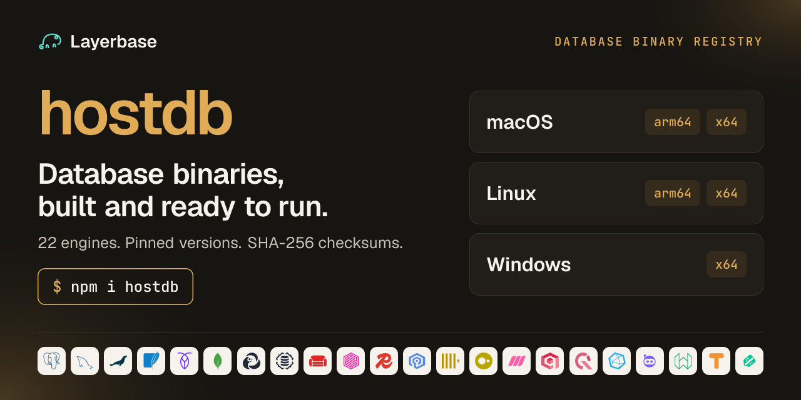

# hostdb

<p align="center">
  <a href="https://github.com/robertjbass/hostdb">
    
  </a>
</p>

[](https://www.npmjs.com/package/hostdb)
[](https://www.npmjs.com/package/hostdb)
[](LICENSE)
[](#supported-engines--platforms)

**Pre-built database binaries, in one place.**

Database binaries are scattered across vendor sites and package managers, and some platforms have none at all. hostdb collects or builds them, hosts them at stable URLs, and gives you one typed API to find the right download.

- **22 database engines:** relational, document, key-value, vector, search, time-series and more
- **Up to five platforms:** macOS and Linux on ARM64 and x64, plus Windows x64
- **SHA-256 checksums:** published with the download metadata
- **Offline version resolution:** the npm package bundles the registry
- **Predictable defaults:** a short version such as MySQL `8` resolves to the LTS release
- **Usable from any language:** the registry is also plain JSON over HTTPS

[Quick start](#quick-start) | [Engines](#supported-engines--platforms) | [Raw JSON](#use-it-from-any-language) | [Maintaining](#maintaining-hostdb) | [License](#license)

> **Want to run a database rather than download one?** Use [SpinDB](https://github.com/robertjbass/spindb), the CLI built on hostdb: `npm i -g spindb`.

## Quick Start

```bash
npm install hostdb
```

```ts
import { getReleaseInfo, listEngines, resolveVersion } from 'hostdb'

resolveVersion('postgresql', '17') // '17.11.0'
resolveVersion('mysql', '8') // '8.4.11' (LTS)
resolveVersion('mongodb', '8') // '8.0.28' (LTS, not the highest 8.x)

getReleaseInfo('postgresql', '17.11.0', 'linux-x64')
// {
//   url: 'https://registry.layerbase.host/...',
//   sha256: '...',
//   size: 11876443,
//   releaseType: 'ga'
// }

listEngines() // engine IDs: 'clickhouse', 'cockroachdb', ...
```

Resolution makes no network calls. Pin an exact hostdb version (no `^` or `~`) if you need the same answers on every install.

### Use it from any language

```bash
# The registry
curl https://registry.layerbase.host/releases.json

# A binary: https://registry.layerbase.host/{tag}/{filename}
curl -O https://registry.layerbase.host/postgresql-17.11.0/postgresql-17.11.0-linux-x64.tar.gz
```

Read exact URLs from the registry rather than building them, because archive formats differ by platform.

## Supported Engines & Platforms

| Engine | Type | Release lines | macOS ARM | macOS Intel | Linux x64 | Linux ARM | Windows |
|---|---|---|:---:|:---:|:---:|:---:|:---:|
| **PostgreSQL** | Relational | 19, 18, 17, 16, 15 | ✅ | ✅ | ✅ | ✅ | ✅ |
| **MySQL** | Relational | 9.7, 9.6, 8.4 | ✅ | ✅ | ✅ | ✅ | ✅ |
| **MariaDB** | Relational | 13.0, 12.3, 11.8, 11.4, 10.11 | ✅ | ✅ | ✅ | ✅ | ✅ |
| **SQLite** | Embedded SQL | 3.53, 3.51 | ✅ | ✅ | ✅ | ✅ | ✅ |
| **libSQL** | Embedded SQL | 0.24 | ✅ | ✅ | ✅ | ✅ | ❌ |
| **CockroachDB** | Distributed SQL | 25.4 | ✅ | ✅ | ✅ | ✅ | ✅ |
| **DuckDB** | Analytical | 2.0, 1.5, 1.4 | ✅ | ✅ | ✅ | ✅ | ✅ |
| **ClickHouse** | Analytical | 25.12 | ✅ | ✅ | ✅ | ✅ | ❌ |
| **MongoDB** | Document | 8.2, 8.0, 7.0 | ✅ | ✅ | ✅ | ✅ | ✅ |
| **FerretDB** | Document | 2.7, 1.24 | ✅ | ✅ | ✅ | ✅ | 1.24 only |
| **DocumentDB** | Document | 1.0 | ✅ | ❌ | ✅ | ✅ | ❌ |
| **CouchDB** | Document | 3.5 | ✅ | ✅ | ✅ | ✅ | ✅ |
| **Redis** | Key-value | 8.4, 7.2 | ✅ | ✅ | ✅ | ✅ | ✅ |
| **Valkey** | Key-value | 9.0, 8.0 | ✅ | ✅ | ✅ | ✅ | ✅ |
| **Qdrant** | Vector | 1.18, 1.16 | ✅ | ✅ | ✅ | ✅ | ✅ |
| **Weaviate** | Vector | 1.38, 1.35 | ✅ | ✅ | ✅ | ✅ | ✅ |
| **Meilisearch** | Search | 1.52, 1.43, 1.33 | ✅ | ✅ | ✅ | ✅ | ✅ |
| **QuestDB** | Time-series | 10.0, 9.4, 9.2 | ✅ | ✅ | ✅ | ✅ | ✅ |
| **InfluxDB** | Time-series | 3.10, 3.8 | ✅ | ✅ | ✅ | ✅ | ✅ |
| **SurrealDB** | Multi-model | 2.3 | ✅ | ✅ | ✅ | ✅ | ✅ |
| **TypeDB** | Graph | 3.14, 3.12 | ✅ | ✅ | ✅ | ✅ | ✅ |
| **TigerBeetle** | Financial ledger | 0.16 | ✅ | ✅ | ✅ | ✅ | ✅ |

FerretDB 2 also needs the `postgresql-documentdb` backend, which hostdb ships for Linux and for macOS 15+ on Apple Silicon. Use `getAvailablePlatforms(engine, version)` to check a specific version.

## How binaries are sourced

1. **Official builds** from the vendor, when they exist
2. **Trusted third-party builds**, such as [MariaDB4j](https://github.com/MariaDB4j/MariaDB4j)
3. **Source builds** for the gaps, using Docker for Linux and GitHub Actions for macOS

Artifacts are published to GitHub Releases and mirrored to `registry.layerbase.host`, so downloads keep working if an upstream source disappears.

## Maintaining hostdb

<details>
<summary><strong>Files, commands and release workflow</strong></summary>

| File | Purpose |
|---|---|
| `databases.yml` | Hand-edited source of truth for engines, versions, platforms and defaults |
| `databases.json` | Generated from `databases.yml` by `pnpm prep` |
| `builds/*/sources.json` | Source URLs for each version and platform |
| `releases.json` | Generated manifest of published releases |

```bash
pnpm dbs                               # List databases
pnpm download:mysql -- --all-platforms # Fetch binaries for packaging
pnpm add:engine <name>                 # Scaffold a new engine
pnpm prep                              # Validate and regenerate data files
pnpm sync:versions                     # Sync workflow version dropdowns
```

To add a version:

1. Add it to `databases.yml`.
2. Add its URLs to `builds/<engine>/sources.json`.
3. Run `pnpm prep`.
4. Run that engine's release workflow in GitHub Actions. It validates the version, builds each platform, publishes the release and updates `releases.json`.

More detail: [architecture](./ARCHITECTURE.md), [archive structure](./BINARIES.md), [new engine checklist](./CHECKLIST.md).

</details>

<details>
<summary><strong>Dependencies between databases</strong></summary>

| Database | Depends On | Cascade Delete | Notes |
|----------|------------|----------------|-------|
| FerretDB | postgresql-documentdb | Yes | postgresql-documentdb is removed when FerretDB is removed (no standalone use) |
| FerretDB (v1) | postgresql | No | Uses plain PostgreSQL as backend; PostgreSQL remains as standalone |
| QuestDB | postgresql | No | PostgreSQL client tools (psql) used for wire protocol; PostgreSQL remains as standalone |

**Cascade Delete** indicates whether removing a database also removes its dependency:
- **Yes**: The dependency exists solely to support this database and is removed together
- **No**: The dependency is a standalone database that remains installed

</details>

## License

hostdb is licensed under [PolyForm Noncommercial 1.0.0](./LICENSE). Commercial use requires a separate license: open an issue or contact the maintainer.

Each database keeps its upstream license, recorded in [`databases.yml`](./databases.yml). Some, including MongoDB, Redis 7.4+, CockroachDB and SurrealDB, have source-available or copyleft terms that can restrict how you modify them or offer them as a service. [FerretDB](https://www.ferretdb.com/) and [Valkey](https://valkey.io/) are permissively licensed alternatives to MongoDB and Redis.

## Acknowledgments

[MariaDB4j](https://github.com/MariaDB4j/MariaDB4j) and [embedded-postgres-binaries](https://github.com/zonkyio/embedded-postgres-binaries) inspired this project. hostdb is built and sponsored by [Layerbase](https://layerbase.com).
